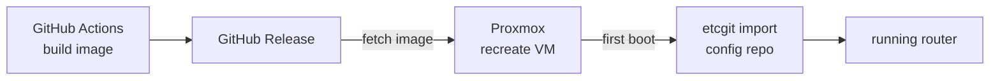

# Actions-OpenWrt — a rebuildable router

[](https://github.com/novkostya/Actions-OpenWrt/actions/workflows/build-openwrt.yml)
[](LICENSE)

Personal setup that builds a custom OpenWrt image for an **x86‑64 router VM on Proxmox** with GitHub
Actions, and runs that router as **cattle, not a pet**. Started from the
[P3TERX/Actions-OpenWrt](https://github.com/P3TERX/Actions-OpenWrt) template (see [Credits](#credits)).

> Personal, home‑use project. Shared in case the approach is useful; no support implied.

## The idea

A home router accumulates state you can't reproduce — packages installed at 2 a.m., a firewall rule you
forgot, config that only ever existed on the box. When it dies or you change hardware, you're stuck. This
repo splits the router into two reproducible halves so it can be thrown away and rebuilt in minutes:

- **The image** is built by CI with the official OpenWrt ImageBuilder from pinned versions and published
  as a GitHub Release, with everything I need baked in. It's defined here and rebuilt rather than
  hand‑crafted on the box, so I can wipe the router and get the same image back.
- **The configuration** (`/etc`) lives in a **separate git repo**, pulled onto the device on first boot and
  then version‑controlled *live* on the running router via a small helper, `etcgit`. Overlay hygiene keeps
  that history honest, so it only shows changes I actually made — not firmware defaults.

So the router is just **image + config**, and recreating it is "fetch the latest release, recreate the VM,
`etcgit import`."

## Rolling it out on Proxmox



The essence on the PVE host (**illustrative — not a runnable script**; `<…>` are placeholders):

```sh
# Fetch the freshly built image from the latest Release
curl -L -o openwrt.img.gz \
  https://github.com/novkostya/Actions-OpenWrt/releases/latest/download/openwrt-x86-64-generic-squashfs-combined-efi.img.gz
gunzip -f openwrt.img.gz

# (Re)create the VM, import the disk, pass the real NICs through, boot
qm create 100 --name openwrt --machine q35 --bios ovmf --ostype l26 --cpu host
qm importdisk 100 openwrt.img local-zfs
qm set 100 --scsihw virtio-scsi-pci --scsi0 local-zfs:vm-100-disk-0 --boot order=scsi0
qm set 100 --hostpci0 <wan-nic> --hostpci1 <lan-nic>
qm start 100

# Then, in the VM console on first boot: add an SSH key and pull the config
etcgit import git@github.com:<you>/<openwrt-config>.git
```

## Building the images

No source build: [`build.sh <device>`](build.sh) runs the official OpenWrt ImageBuilder for a device
directory, in a few minutes:

- `<device>/device.env`: target, profile and build options
- `<device>/versions.env`: OpenWrt version, sing-box, AmneziaWG (awg-openwrt) and their checksums, all
  pinned; bump them only here, in a commit, so every release maps to one commit
- `<device>/packages.txt`: extra packages on top of the ImageBuilder defaults (no LuCI)
- [`files/`](files) (shared) plus `<device>/files/`: the overlay

It runs locally (output in `.build/<device>/out`) or via the manual workflows, which publish a release
when run on `master` and upload a test build as a workflow artifact when run on any other branch. Image
file names carry no version (it is in the release tag), so `releases/latest/download/...` stays a stable
URL.

## The x86 VM image

[`x86/`](x86), built by the **Build OpenWrt** workflow: the VM's packages, sing-box from the upstream
release build (the OpenWrt package stays for its init script and UCI config) and qemu-ga enabled. Its
releases (`v<openwrt-version>_*`) are the ones marked latest.

## Second device: Linksys MX5500 access point

The same image + `/etc` repo approach for a Linksys MX5500 that serves Wi-Fi and stands by as a VRRP
backup router for the VM. [`mx5500/`](mx5500), built by the **Build MX5500 AP** workflow: no LuCI, a slim
sing-box built from a pinned upstream tag (QUIC only, for a backup Hysteria2 Realms exit) and AmneziaWG.
Its `mx5500_*` releases are never marked latest, so `releases/latest` keeps pointing at the VM image.

Installing from a release: `sysupgrade` (keeps settings) with the `*-sysupgrade.bin`. On this device it
writes the other firmware slot and boots it, so the previous image stays as a fallback.

## Credits

Started from **[P3TERX/Actions-OpenWrt](https://github.com/P3TERX/Actions-OpenWrt)**, the "Building OpenWrt
with GitHub Actions" template; its source build has since been replaced by ImageBuilder builds. This setup
targets an x86‑64 Proxmox VM and a Linksys MX5500, and adds the `etcgit` / overlay tooling. Also builds on
[OpenWrt](https://github.com/openwrt/openwrt), [awg-openwrt](https://github.com/Slava-Shchipunov/awg-openwrt),
[sing-box](https://github.com/SagerNet/sing-box) and the packages and GitHub Actions the workflows pull in.

## License

[MIT](LICENSE) © 2019–2020 [P3TERX](https://p3terx.com) (original template), with modifications by the
repository owner.
